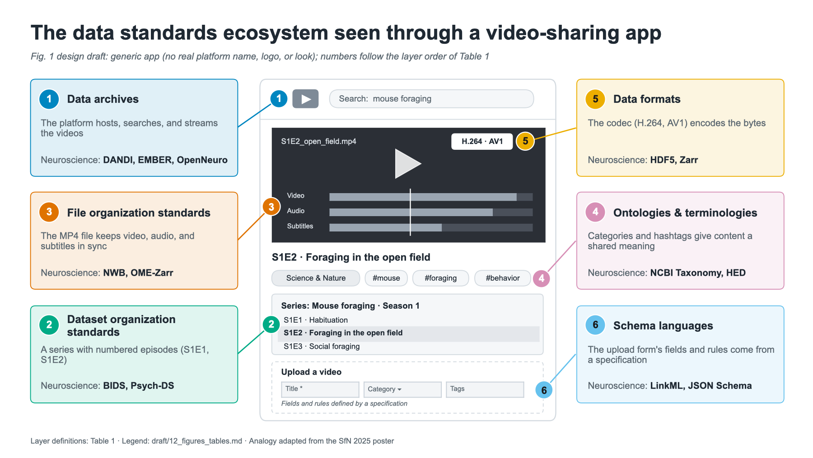
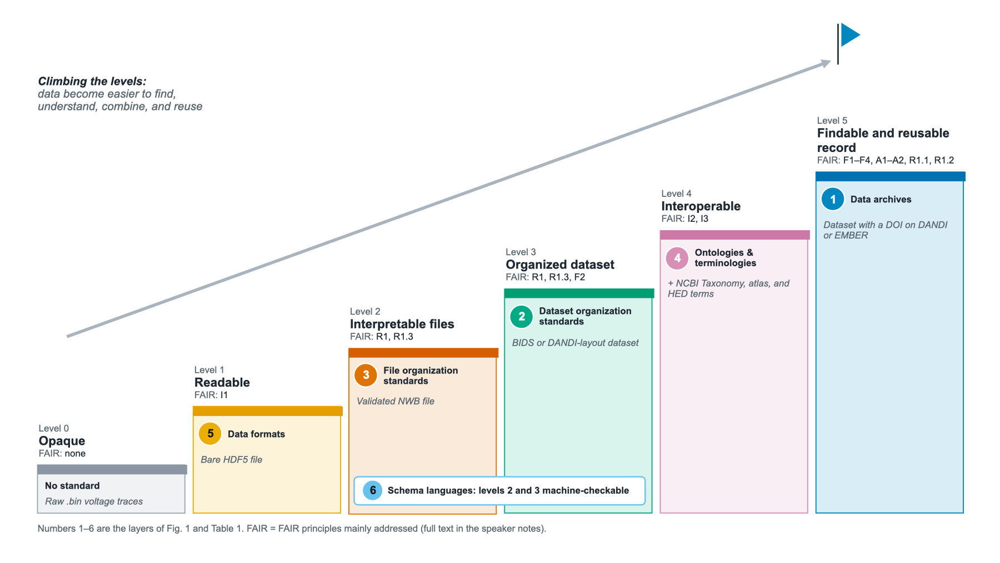
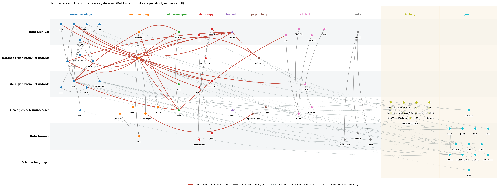
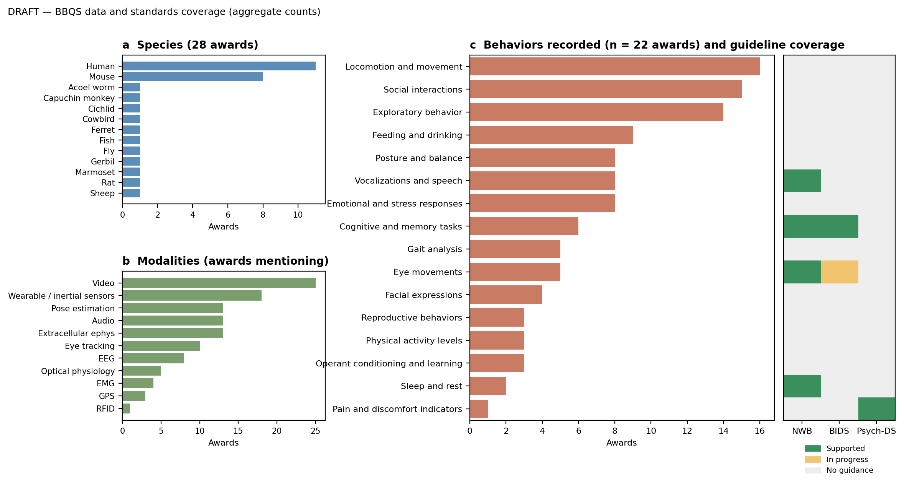
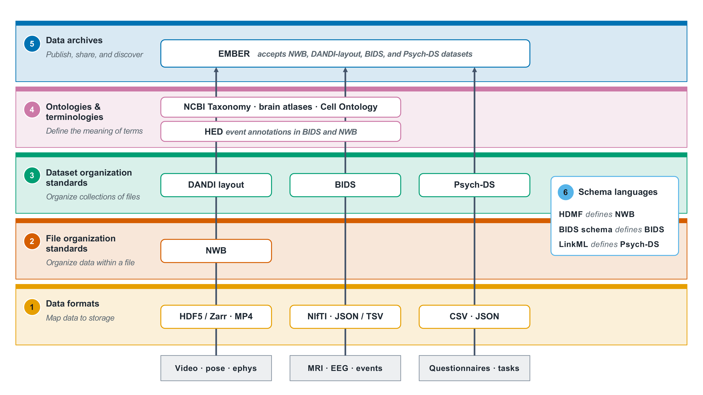

# Display items

Files: `figures/` (one folder per item; `figures/README.md`). Status: **spec** = described only; **draft** = generated draft exists; **poster** = redraw from poster.
Scientific Data recommends at most 8 figures and 10 tables; the 6 figures and 3 tables fit (tables are kept here, not in the section files). Figure legends
must total ≤350 words (F6).

| # | Item | Section | Status | Source / file |
|---|---|---|---|---|
| Fig. 1 | The ecosystem seen through a video-sharing app (single panel) | 2 | design draft (PowerPoint) | `figures/fig1_ecosystem_map/` |
| Table 1 | Layer definitions | 2 | draft (below) | poster table |
| Fig. 2 | Levels of FAIRness as a staircase, with the layer that adds each level | 3 | design draft (PowerPoint) | `figures/fig2_fair_levels/` |
| Table 2 | Levels of FAIRness, the layers that enable them, and the FAIR principles they address | 3 | draft (below) | |
| Fig. 3 | Ecosystem knowledge graph (layers × communities) | 4 | draft | `figures/fig3_knowledge_graph/` (`make fig3`) |
| Fig. 4 | BBQS data: (a) species, (b) modalities, (c) behaviors × guideline coverage | 5, 8 | draft | `figures/fig4_bbqs_data/` (`make fig4`) |
| Fig. 5 | BBQS standards stack on the map | 6 | design draft (PowerPoint) | `figures/fig5_bbqs_stack/` |
| Table 3 | Recommended standards by BBQS data type | 7 | draft (below) | BBQS guideline |
| Fig. 6 | Bridges at every layer + future directions | 8, 9 | spec / poster | `figures/fig6_bridges_future/` |
| Suppl. Table S1 | The 41 RDA FAIR indicators mapped to the levels of FAIRness and the layers that contribute | 3 | draft (below) | RDA FAIR Data Maturity Model v1.0; FAIRsFAIR metrics v0.8 |

---

## Fig. 1 — The data standards ecosystem seen through a video-sharing app

**Sharing data, like sharing a video, relies on several technologies that each solve one problem.**
Uploading a video looks like a single step but depends on six independently developed technologies: the
codec that encodes the bytes (1), the MP4 file that keeps synchronized video, audio, and subtitles
together (2), playlists that organize videos into series of episodes (3), standardized categories and
hashtags (4), the platform that hosts and searches videos (5), and the upload form whose fields and rules
come from a formal specification (6). Each corresponds to one layer of the neuroscience data standards
ecosystem, numbered as in Table 1; callouts give neuroscience examples. No single technology makes a video
shareable; it works because the layers fit together. The same holds for neuroscience data.

## Table 1 — Layers of the ecosystem

| # | Layer | Problem | Use case | Examples |
|---|---|---|---|---|
| 1 | Data formats | Map data to storage | Serialize generic data structures | HDF5, Zarr, TIFF, NIfTI, JSON, YAML, CSV/TSV, MP4 |
| 2 | File organization standards | Organize data and metadata within a file, using primitives supported by formats | Organize data from one session or modality | NWB, OME-TIFF/OME-Zarr, NIX, odML, openMINDS, DICOM, EDF |
| 3 | Dataset organization standards | Organize collections of files in accepted standards and formats | Organize data from a full experiment | BIDS, Psych-DS, DANDI layout, SPARC SDS, NeuroBlueprint |
| 4 | Ontologies & terminologies | Define terms and represent domain knowledge, incl. relationships | Annotate data to define the meaning of terms | NCBI Taxonomy, Uberon, Cell Ontology, Allen CCF, HED, Cognitive Atlas, NBO |
| 5 | Data archives | Publish, share, and discover content | Publish a series of datasets on a topic | DANDI, EMBER, OpenNeuro, NEMAR, DABI, BIL, BossDB, NDA, EBRAINS, SPARC |
| 6 | Schema languages | Provide a formal language for the structure and rules of data | Formally define file organization standards, dataset organization standards, and ontologies | JSON Schema, XML Schema, RDF/OWL, LinkML, HDMF |

## Fig. 2 — The layers of the ecosystem and the levels of FAIRness they enable

**Each level of FAIRness requires technologies from an additional layer.** Six levels of FAIRness
(Table 2) drawn as a staircase. Each step is styled and numbered like the layer in Fig. 1 that adds it, and
labelled with the FAIR principles it mainly addresses. An example
dataset climbs the steps (raw binary file → bare HDF5 → validated NWB file → BIDS or DANDI-layout dataset →
terms from NCBI Taxonomy, an atlas, and HED → DOI on DANDI or EMBER). Schema languages make levels 2 and 3
machine-checkable.

## Table 2 — Levels of FAIRness and the layers that enable them

Each level is defined by what a third party can do with the data. Suppl. Table S1 maps the levels and
layers to the indicators of the RDA FAIR Data Maturity Model.
\* Schema languages make conformance at levels 2 and 3 machine-checkable.

| Level | What the data offer | Layer that adds it | FAIR principles mainly addressed | Example |
|---|---|---|---|---|
| 0, opaque | Bytes that can only be read with the original software or documentation | None | None | Proprietary acquisition files without a public specification; raw `.bin` voltage traces |
| 1, readable | Data in an open, documented format that generic tools can read, with technical metadata such as data types and dimensions | Data formats | I1 (formal, shared representation) | Bare HDF5, Zarr, TIFF, or CSV files |
| 2, interpretable files | Each file, for example one recording session, has a standardized structure and contains the metadata needed to understand it | File organization standards\* | R1 (rich metadata), R1.3 (community standards) | A validated NWB file |
| 3, organized dataset | The whole experiment can be navigated, with consistent file names, folder structure, and dataset-level metadata | Dataset organization standards\* | R1, R1.3, F2 (data described with rich metadata) | A validated BIDS or DANDI-layout dataset |
| 4, interoperable | Metadata values are drawn from shared terminologies and ontologies, so that datasets can be searched and combined with others | Ontologies and terminologies | I2 (FAIR vocabularies), I3 (qualified references) | NWB or BIDS data with species from the NCBI Taxonomy, locations from an atlas, and events annotated with HED |
| 5, findable and reusable record | Data are deposited with a persistent identifier, searchable metadata, licence, and provenance, and can be retrieved through a standard protocol | Data archives (with persistent identifiers) | F1–F4, A1–A2, R1.1 (licence), R1.2 (provenance) | An annotated BIDS and NWB dataset with a DOI on DANDI or EMBER |

## Fig. 3 — Connections in the ecosystem

Knowledge graph of 72 technologies (nodes) and the 110 connections between them (edges; one line per pair
of technologies, which may be linked by several relationships), drawn with the six layers as
rows and the community in which each technology originated as columns; shared, domain-agnostic
infrastructure (general, cross-species biology) is on the right. Edges are styled by scope: relationships
between communities (red), within a community (grey), and with shared infrastructure (dashed). Dots mark
relationships also recorded in a registry (RRID or FAIRsharing). Bridges between communities concentrate
on BIDS, NWB, HED, and EMBER.

## Fig. 4 — BBQS data and standards coverage

**(a)** Species groups across 28 awards. **(b)** Behavioral and neural modalities (awards mentioning
each). **(c)** Behavior types reported by projects (bars: number of awards, n = 22) and, for each, the
level of guidance in NWB, BIDS, and Psych-DS (supported / in progress / no guidance). Aggregate data
only.

## Fig. 5 — The BBQS standards stack

**BBQS has at least one recommended technology in every layer.** The layers of the map stacked in
Table 1 order, from data formats (1) at the bottom to data archives (5) at the top, with the technologies
recommended for BBQS; schema languages (6) define the file and dataset organization standards. Arrows
show three typical paths from raw data to the EMBER archive: video, pose, and electrophysiology through
NWB and the DANDI layout; MRI, EEG, and events through BIDS; and questionnaires and task responses
through Psych-DS. A path that crosses a row without a technology does not use that layer.

## Table 3 — Recommended standards for common BBQS data types

✓ supported; ext. = via an extension or proposal in progress; — no established representation yet.
*Draft; to be checked by the NWB, BIDS, and
Psych-DS teams* [TODO-C17].

| Data type | NWB | BIDS | Psych-DS | Notes |
|---|---|---|---|---|
| Extracellular ephys (spikes, LFP) | ✓ (recommended) | ext. (BEP032) | — | |
| Intracellular ephys (patch clamp) | ✓ (recommended) | — | — | |
| Calcium / optical physiology | ✓ (recommended) | — | — | |
| EEG / MEG / iEEG, standalone | ✓ (combined studies) | ✓ (recommended) | — | EDF as interchange format |
| MRI / fMRI / PET | — | ✓ (recommended) | — | |
| Optogenetic / electrical stimulation | ✓ (recommended) | — | — | |
| Raw behavioral video | ✓ (linked MP4 etc.) | ext. (proposals in progress) | ✓ (raw folder) | |
| Pose / motion tracking | ✓ (ndx-pose) | ✓ (Motion-BIDS) | tabular only | |
| Eye tracking | ✓ | ext. (BEP020) | tabular only | |
| Wearable sensors | ✓ (TimeSeries) | ✓ (physio recordings) | ✓ (CSV) | |
| Audio / vocalizations | ✓ (TimeSeries + intervals) | — | — | |
| Structured tasks / events | ✓ (core events since NWB 2.10; ndx-structured-behavior) | ✓ (task events) | — | HED in both |
| Questionnaires / surveys | — | partial | ✓ (recommended) | |
| Social interactions, feeding, facial expressions, home-cage monitoring, VR, force plates, EMG | — | — / ext. | — | **Gaps** (Section 8) |

## Fig. 6 — Bridges and future directions

*Not yet drawn (spec only).*

**(a)** Six types of bridges placed on the map (structural; schema language; semantic — schema
elements; semantic — values; archive linking; dataset-level common data elements). **(b)** Future
directions (living data, data reuse, integration across modalities and archives, AI and new technologies, coordination centers)
and cross-cutting needs (education and training, outreach and community engagement, maintenance and
support), redrawn from the poster.

## Supplementary Table S1 — The RDA FAIR indicators by level of FAIRness and layer

All 41 indicators of the RDA FAIR Data Maturity Model [REF: RDA FDMM 2020] (prefix "RDA-" omitted; M =
metadata, D = data) with their RDA priority, the level of FAIRness (Table 2) that mainly adds each indicator, the layers that contribute (● primary, ○ supporting; columns 1–6 are the layers numbered as in Table 1: 1 data formats, 2 file organization, 3 dataset organization, 4 ontologies & terminologies, 5 data archives, 6 schema languages), and the
closest FAIRsFAIR metric used by F-UJI (v0.8; prefix "FsF-" omitted; — none) [REF: FAIRsFAIR metrics v0.8]. Primary / any
contribution: (1) formats 2 / 4; (2) file organization 12 / 17; (3) dataset organization 9 / 19; (4) ontologies & terminologies 3 / 8; (5) archives 24 / 32; (6) schema languages 5 / 7. Level 5 indicators (F, A, R1.1, R1.2) are met when an archive publishes the record; F2 and R1.2 also
rely on content from levels 2–3. *Draft; to be checked with a FAIR expert* [TODO-C6].

| Indicator | Short text | Priority | Level | 1 | 2 | 3 | 4 | 5 | 6 | How the layers contribute | FAIRsFAIR metric |
|-----------|--------------------------|---------|:---:|:-:|:-:|:-:|:-:|:-:|:-:|-----------------------------|-------------|
| F1-01M | Metadata identified by a persistent identifier | essential | 5 |  |  |  |  | ● |  | Archive mints a DOI for the dataset record | F1-02MD |
| F1-01D | Data identified by a persistent identifier | essential | 5 |  |  |  |  | ● |  | DOI for each published dataset version | F1-02MD |
| F1-02M | Metadata identified by a globally unique identifier | essential | 5 |  |  | ○ |  | ● |  | Archive identifiers; dataset description can record the DOI (BIDS) | F1-01MD |
| F1-02D | Data identified by a globally unique identifier | essential | 5 |  | ○ |  |  | ● |  | Archive asset identifiers; files carry their own UUID (NWB `object_id`) | F1-01MD |
| F2-01M | Rich metadata is provided to allow discovery | essential | 5 |  | ● | ● | ○ | ● |  | Archives index metadata extracted from NWB files and BIDS/Psych-DS descriptions; terms add searchable meaning | F2-01M |
| F3-01M | Metadata includes the identifier for the data | essential | 5 |  |  |  |  | ● |  | Landing page links record and data | F3-01M |
| F4-01M | Metadata can be harvested and indexed | essential | 5 |  |  |  |  | ● | ○ | Archive exposes metadata (e.g., schema.org JSON-LD) to search engines | F4-01M |
| A1-01M | Metadata contains information on how to access the data | important | 5 |  |  |  |  | ● |  | Access conditions on the landing page | A1-01M |
| A1-02M | Metadata can be accessed manually | essential | 5 |  |  |  |  | ● |  | Web portal | — |
| A1-02D | Data can be accessed manually | essential | 5 |  |  |  |  | ● |  | Download from the portal | — |
| A1-03M | Metadata identifier resolves to a metadata record | essential | 5 |  |  |  |  | ● |  | DOI resolves to landing page | A1-02MD |
| A1-03D | Data identifier resolves to a digital object | essential | 5 |  |  |  |  | ● |  | Identifier resolves to the data | A1-02MD |
| A1-04M | Metadata accessed through a standardised protocol | essential | 5 |  |  |  |  | ● |  | HTTPS / REST API | A1-02MD |
| A1-04D | Data accessible through a standardised protocol | essential | 5 | ○ |  |  |  | ● |  | HTTPS / S3; cloud-friendly formats (Zarr, HDF5) allow partial reads | A1-02MD |
| A1-05D | Data can be accessed automatically | important | 5 | ○ |  |  |  | ● |  | APIs and command-line clients; cloud-friendly formats | — |
| A1.1-01M | Metadata accessible through a free access protocol | essential | 5 |  |  |  |  | ● |  | Open web protocols | A1.1-01MD |
| A1.1-01D | Data accessible through a free access protocol | important | 5 |  |  |  |  | ● |  | Open web protocols | A1.1-01MD |
| A1.2-01D | Data access supports authentication and authorisation | useful | 5 |  |  |  |  | ● |  | Controlled-access tiers (e.g., for human data) | A1.2-01MD |
| A2-01M | Metadata remains available after data are no longer available | essential | 5 |  |  |  |  | ● |  | Archive preservation policy | — |
| I1-01M | Metadata uses knowledge representation in a standardised format | important | 3 | ● | ● | ● |  | ○ |  | Metadata in JSON/TSV sidecars (BIDS, Psych-DS) or HDF5 attributes (NWB) | I1-01M |
| I1-01D | Data uses knowledge representation in a standardised format | important | 1 | ● | ○ |  |  |  |  | Open, documented formats (HDF5, Zarr, NIfTI, TIFF, CSV) | R1.3-02D |
| I1-02M | Metadata uses machine-understandable knowledge representation | important | 3 |  | ● | ● |  | ○ | ● | Metadata fields defined in machine-readable schemas (BIDS schema, HDMF/NWB specification, LinkML, JSON-LD) | I1-01M |
| I1-02D | Data uses machine-understandable knowledge representation | important | 2 |  | ● | ○ |  |  | ● | Data types defined in a schema language (e.g., NWB types in the HDMF language) | — |
| I2-01M | Metadata uses FAIR-compliant vocabularies | important | 4 |  | ○ | ○ | ● |  |  | Terms from NCBI Taxonomy, Uberon, atlases, Cognitive Atlas; standards define the fields that hold them | I2-01M |
| I2-01D | Data uses FAIR-compliant vocabularies | useful | 4 |  | ○ | ○ | ● |  |  | Annotations in the data, e.g., HED strings for events | — |
| I3-01M | Metadata includes references to other metadata | important | 4 |  |  | ○ | ○ | ● |  | Archive links related datasets and publications | I3-01M |
| I3-02M | Metadata includes references to other data | useful | 4 |  |  | ● |  | ● |  | Dataset descriptions reference source data (BIDS `Sources`, derivatives) | I3-01M |
| I3-03M | Metadata includes qualified references to other metadata | important | 4 |  |  | ○ | ● | ○ |  | Typed relations from ontologies; DataCite relation types | I3-01M |
| I3-04M | Metadata includes qualified references to other data | useful | 4 |  | ○ | ● |  | ○ |  | Typed links between files (BIDS `IntendedFor`); DataCite relation types | I3-01M |
| I3-01D | Data includes references to other data | useful | 4 |  | ● | ○ |  |  |  | Links inside files (NWB links, external video files) | — |
| I3-02D | Data includes qualified references to other data | useful | 4 |  | ● | ○ | ○ |  |  | Typed links in NWB; links to ontology terms (HERD) | — |
| R1-01M | Plurality of accurate and relevant attributes for reuse | essential | 3 |  | ● | ● | ○ | ○ |  | Required and recommended metadata defined by the standards | R1-01M |
| R1.1-01M | Metadata includes the licence | essential | 5 |  |  | ○ |  | ● |  | Archive licence; BIDS `License` field | R1.1-01M |
| R1.1-02M | Metadata refers to a standard reuse licence | important | 5 |  |  |  |  | ● |  | Standard licences (e.g., CC0, CC-BY) | R1.1-01M |
| R1.1-03M | Metadata refers to a machine-understandable reuse licence | important | 5 |  |  |  |  | ● |  | Licence as SPDX identifier or URI | R1.1-01M |
| R1.2-01M | Provenance according to community-specific standards | important | 5 |  | ● | ● |  | ○ |  | NWB source and processing metadata; BIDS `GeneratedBy` and derivatives | R1.2-01M |
| R1.2-02M | Provenance according to a cross-domain language | useful | 5 |  |  |  | ○ | ○ | ● | PROV-based models (W3C PROV, NIDM) | R1.2-01M |
| R1.3-01M | Metadata complies with a community standard | essential | 3 |  | ● | ● |  | ○ | ○ | Dataset and file metadata follow BIDS, Psych-DS, or NWB | R1.3-01M |
| R1.3-02M | Metadata expressed in a machine-understandable community standard | essential | 3 |  | ● | ● |  |  | ● | Validators check metadata against the standard's schema | R1.3-01M |
| R1.3-01D | Data complies with a community standard | essential | 2 |  | ● | ○ |  |  |  | Files follow NWB, OME-Zarr, or other file organization standards | R1.3-02D |
| R1.3-02D | Data expressed in a machine-understandable community standard | important | 2 |  | ● |  |  |  | ● | File structure defined in a schema and checked by validators (NWB Inspector) | R1.3-02D |
